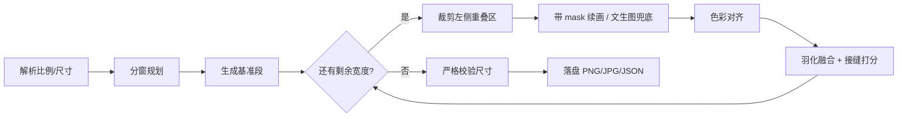

# Wide Panorama：突破单次 3:1 的宽图生成

用「受限生成器 + 重叠窗口续画 + 羽化融合」拼出 6:1、8:1 甚至更宽的全景图。
单次生成的画布比例始终 ≤ 3:1，最终尺寸严格等于目标尺寸，**不靠拉伸、不靠裁切、不留白**。

> GitHub 仓库：<https://github.com/songmumu-1024/wide-panorama> （Gitee 镜像：<https://gitee.com/zsl-wdk/wide-panorama>）
>
> 仓库保留离线 `mock` 后端用于跑通链路和回归测试；`outputs/` 中的 6:1 / 8:1 案例由真实图片接口生成（见第 6、7 节）。
>
> 📘 从零开始的完整教程（题目解析 → 业务流程图 → 公式推导 → 环境准备 → 真实出图 → Docker/CentOS/公网部署 → 测试验收）：
> [`docs/开发文档.md`](docs/开发文档.md)

---

## 1. 题目本意拆解

题面表面在问「怎么生成超宽图」，实际考的是三件事：

| 题面要求 | 翻译成工程约束 |
|---|---|
| 单次 API 最大约 3:1 | 不能一次画完，必须把一张图拆成多次生成再拼 |
| 最终比例超过 3:1，至少 6:1 / 8:1 | 支持任意目标比例，并保证最终宽度严格达标 |
| 内容连贯，不能靠拉伸/裁切/留白 | 新增区域必须由模型**真的画出来**，不是把已有像素变形或填色 |
| 主体、构图、风格、光照、细节一致 | 每次生成都要看到上一段画面，并有明确的风格锚定 |
| 交付代码 + 在线 Demo + 案例 + 说明 | 工程完整度：可运行、可交互、可复现、可解释 |

所以正确路线不是"找一个能出 8:1 的模型"，而是：

> 把「生成一张图」改造成「在一个已有画面的边缘，继续画下一段」——也就是 outpainting。

三种错误做法（题面明确禁止）：

- **拉伸**：把 3:1 横向拉成 8:1 → 主体变形；
- **裁切**：先出 3:1 再裁上下 → 宽度没变，比例根本没到 8:1；
- **留白**：两边补纯色/模糊 → 信息缺失，一眼假。

---

## 2. 核心思路

### 2.1 关键认知：3:1 限制的是「单次画布」，不是「最终画面」

模型每次只能输出 ≤ 3:1 的画布，但画布可以**重叠**：新画布左侧压住旧图的右边缘，
模型看到这段上下文后向右续画，再把重叠区域融合掉。

```
第 1 次:  [========== 3H ==========]
第 2 次:                 [--重叠--|==== 新增 ====]
                                            ↑ 画布宽度 = 重叠 + 新增 ≤ 3H
```

### 2.2 尺寸推导

设段高 `H`、单次上限 `P=3`、重叠 `o`：

```
基准段宽      = min(W, P·H)
单次最大新增  = P·H − o
延伸次数 n    = ceil((W − P·H) / (P·H − o))
第 i 次画布   = o + 新增_i ≤ P·H      ← 永远不超限
最终宽度      = P·H + Σ新增_i = W     ← 严格达标
```

以 `H=1024, P=3, o=464`（重叠 15%）为例：

| 目标 | 最终尺寸 | 基准段 | 各次新增 | 调用次数 | 画布比例（均 ≤3） |
|---|---|---|---|---|---|
| 6:1 | 6144×1024 | 3072 | 1536 + 1536 | 3 | 1.95 |
| 8:1 | 8192×1024 | 3072 | 2560 + 2560 | 3 | 2.95 |
| 12:1 | 12288×1024 | 3072 | 2304×4 | 5 | 2.70 |

注意：**6:1 和 8:1 都是 3 次调用**。因为新增宽度是按剩余总量均分的，
不需要为了凑比例多画一整段。

### 2.3 一致性的四道保险

1. **上下文图（最强约束）**：续画时把上一段的重叠区作为 `image` 输入，模型直接看到左边界的地平线、光照、色温。
2. **提示词锚定**：每次调用都带同一段全局场景描述 + 方向指令 + 「不要重复主体 / 不要接缝 / 不要文字」。
3. **色彩统计对齐**：用**重叠区**（而不是整段）估计源图的均值/方差，再映射到左侧参考区，避免不同调用的色温漂移。
   若用整段估计，内容差异会把整幅图的颜色校偏，这是很容易踩的坑。
4. **羽化融合 + 指标校验**：重叠区用 smoothstep 权重过渡（两端导数为 0，不会有硬边）；
   拼完立即计算接缝处的列梯度 / 邻域梯度中位数，作为可量化的验收指标。

---

## 3. 管线与代码位置



| 模块 | 职责 |
|---|---|
| [`app/geometry.py`](app/geometry.py) | 比例解析、`plan_canvas` 分窗规划（8 像素对齐） |
| [`app/imaging.py`](app/imaging.py) | 色彩对齐、重叠羽化、接缝/色差指标 |
| [`app/pipeline.py`](app/pipeline.py) | 生成管线编排、进度回调、元数据落盘 |
| [`app/providers/`](app/providers) | 后端抽象：`mock`（离线）/ `openai_compat`（真实 API） |
| [`app/main.py`](app/main.py) | FastAPI 接口 + 作业轮询 |
| [`static/index.html`](static/index.html) | 在线 Demo 前端 |
| [`scripts/selfcheck.py`](scripts/selfcheck.py) | 无网络自检（几何 + 端到端） |
| [`scripts/make_examples.py`](scripts/make_examples.py) | 批量生成交付案例 |
| [`scripts/probe_api.py`](scripts/probe_api.py) | 网关探测：模型列表、尺寸上限、`edits` 是否可用 |

### 3.1 为什么是「先出基准段，再一直往右扩」

- 每次只多画一段，模型需要维持的上下文长度固定，风格漂移可控；
- 每段都与上一段重叠，误差是**局部**的，不会一次放大到整幅；
- 失败可重试单段，不必重跑整张图。

---

## 4. 项目结构

```
wide-panorama/
├── app/
│   ├── config.py          # 环境变量配置
│   ├── geometry.py        # 比例解析 + 分窗规划
│   ├── imaging.py         # 色彩对齐 / 羽化 / 指标
│   ├── pipeline.py        # 生成管线
│   ├── jobs.py            # 内存作业队列
│   ├── main.py            # FastAPI
│   └── providers/
│       ├── base.py
│       ├── mock.py
│       └── openai_compat.py
├── static/index.html      # Demo 前端
├── scripts/               # 自检 / 案例生成 / 网关探测
├── docs/开发文档.md        # 保姆级全流程教程
├── outputs/               # 案例图 + 元数据
├── requirements.txt
├── .env.example
└── Dockerfile
```

---

## 5. 快速开始

环境要求：**Python 3.10+**（本机实测 3.13.9），依赖见 [`requirements.txt`](requirements.txt)（FastAPI、Uvicorn、Pillow、NumPy、Requests、python-multipart）。默认 `mock` 模式，无需 API Key 即可跑通。

```powershell
python -m pip install -r requirements.txt
python scripts\selfcheck.py          # 离线自检，无需 API Key
python scripts\make_examples.py      # 生成 6:1 / 8:1 案例（默认 mock）
python -m uvicorn app.main:app --port 8000
# 打开 http://127.0.0.1:8000
```

Demo 支持输入提示词、选择/自定义比例、选择高度，也可以直接填目标宽度，实时显示进度、分段指标和下载链接。右侧预览区按 68vh 展示大图，并提供「适应窗口 / 1:1 原始尺寸 / 全屏查看」三种查看方式；「高清增强」用轻度 USM 补偿网关降采样带来的软感。接口校验：目标宽高比必须 **>3:1**、宽度为 8 的倍数、总宽 ≤16384px；默认最多 2 个任务并发（`MAX_CONCURRENT_JOBS`），超出返回 429。

---

## 6. 接入真实图片接口

复制 `.env.example` 为 `.env` 并填入配置（`app/config.py` 启动时自动读取 `.env`，已存在的环境变量优先）：

```ini
IMAGE_PROVIDER=openai
IMAGE_API_BASE_URL=https://<你的网关>/v1
IMAGE_API_KEY=<你的 Key>
IMAGE_MODEL=gpt-image-1.5
```

先探测网关能力，再跑案例：

```powershell
python scripts\probe_api.py --matrix --model gpt-image-1.5
python scripts\make_examples.py --height 1024
```

接口冒烟测试（默认只跑参数校验类用例，零成本）：

```powershell
python scripts\smoke_test.py --base http://127.0.0.1:8000
python scripts\smoke_test.py --base http://127.0.0.1:8000 --generate   # 额外跑一次真实 6:1
```

本次实测的网关行为（`https://www.cnxmai.com/v1`）：

- `gpt-image-1.5`、`gpt-image-2.5-flare` 可用；`gpt-image-1` 会因 `complexity` 参数被网关拒绝。
- 接受任意 `WxH` 并保持比例返回，但单次输出约 **1.57MP**（`2000×1024` → `1752×897`，`3072×1024` → `2172×724`），管线会按目标画布做 **等比 cover 缩放**（必要时居中裁切），不会拉伸变形。
- `POST /images/edits` 可用，因此续画走真实 outpaint 而非文生图兜底。

实现假设（都可在 `openai_compat.py` 里按实际网关调整）：

- 文生图：`POST {base}/images/generations`，返回 `data[0].b64_json` 或 `data[0].url`；
- 续画：`POST {base}/images/edits`，`image` 为「上下文 + 初始填充」，`mask` 的透明区表示允许重绘；
- 若网关不接受任意 `WxH`，把 `IMAGE_SIZE_MODE` 设为 `auto`（先试精确尺寸，失败回退 `IMAGE_PRESET_SIZES`）或 `preset`；
- 若网关没有 `edits`，设 `IMAGE_ENABLE_EDITS=0`，管线自动退化为「文生图 + 色彩对齐 + 融合」，接缝质量会下降，但流程仍然成立。

> 只支持纯文生图时，一致性只能靠提示词与色彩对齐，务必在 README/演示中如实说明。

---

## 7. 实测结果

真实接口实测（2026-11-05，`gpt-image-1.5`，提示词「黄昏时分的海岸线，远处灯塔，平静海面，电影感光线」）：

| 比例 | 输出尺寸 | 调用次数 | 最大单次画布比例 | 重叠 | 最大接缝指标 | 耗时 |
|---|---|---|---|---|---|---|
| 6:1 | 6144×1024 | 3 | 1.95:1 | 464px | 0.97 | 133s |
| 8:1 | 8192×1024 | 3 | 2.95:1 | 464px | 1.40 | 85s |

- 接缝指标 = 接缝处列梯度 / 邻域列梯度中位数，≈1 表示与周围纹理一致；>2.5 视为明显接缝。
- 逐段模式均为 `base` + `edits` ×2；每次画布比例严格 ≤3:1，最终尺寸由 3072 + 1536×2（或 2560×2）精确累加得到。
- 案例文件：[`outputs/case_6x1x1.png`](outputs/case_6x1x1.png)、[`outputs/case_8x1x1.png`](outputs/case_8x1x1.png)；
  同名 `.json` 记录逐段模式、色差、接缝分数、耗时，可直接作为一致性验证材料。
- 预览图：[`outputs/preview_6x1x1.png`](outputs/preview_6x1x1.png)、[`outputs/preview_8x1x1.png`](outputs/preview_8x1x1.png)。

> 早期版本用镜像填充（`np.pad(mode="reflect")`）初始化待续画区域，8:1 案例的天空出现明显的左右镜像云层；
> 改为边缘复制（`mode="edge"`）后重新生成，镜像消失。这条经验已写进 `openai_compat._edit` 的注释。

`mock` 后端仍可离线复现几何与融合：

```powershell
python scripts\make_examples.py --provider mock --height 1024
```

### 验收测试（本地 Mock，零成本）

2026-11-05 执行 `scripts/smoke_test.py`：

- 9 项接口用例全部 PASS：空提示词 422、`2:1` / 宽度 `3072@1024`（比例=3）拒绝、比例格式非法、宽度非 8 倍数、总宽超限、未知任务 404、路径穿越 404；
- 1 次 6:1 生成（3072×512）全部通过：尺寸严格 6.00、单次画布 1.95:1、接缝 1.59；
- `MAX_CONCURRENT_JOBS=1` 时并发提交返回 `429`，同一时刻只放行一个任务；
- 自定义宽度 `width=5000, height=512` 输出精确为 5000×512，4 次调用，无取整漂移。

> Mock 画面是程序化场景（黄昏海岸 + 灯塔），用于验证「几何正确、融合无接缝、尺寸严格达标」，**不要当作 AI 案例提交**。
> 它输出的接缝指标稳定在 1.11 附近；真实模型会随画面内容波动，因此第 7 节同时列出真实值与耗时。

---

## 8. 部署在线 Demo

本地：

```powershell
python -m uvicorn app.main:app --host 0.0.0.0 --port 8000
```

Docker（推荐；镜像不含 Key，`.env` 已在 `.dockerignore` 中排除，运行时通过 `--env-file` 注入）：

```powershell
docker build -t wide-panorama .
docker run -d --name wide-panorama -p 8000:8000 `
  --env-file .env `
  -v "${PWD}\outputs:/app/outputs" `
  --restart unless-stopped `
  wide-panorama
```

或使用 compose（等价，少敲命令）：

```powershell
docker compose up -d --build
docker compose ps
docker compose logs -f
```

- 容器默认监听 `8000`，可用环境变量 `PORT` 覆盖（Hugging Face Spaces 用 `7860`）。
- `outputs/` 通过卷挂载，容器重建不会丢案例。
- 镜像内置 `HEALTHCHECK`，会周期性请求 `/api/health`。
- 不配置 Key 时以 `mock` 模式运行，页面会显示「演示后端」标识。

部署到 Linux VM（Ubuntu/Debian 示例）：

```bash
curl -fsSL https://get.docker.com | sudo sh
sudo usermod -aG docker $USER && newgrp docker
unzip wide-panorama-deploy.zip -d ~/wide-panorama && cd ~/wide-panorama
cp .env.example .env && nano .env      # 填 Base URL / Key / 模型
docker compose up -d --build
curl http://127.0.0.1:8000/api/health
```

公网访问需放行 8000 端口（`sudo ufw allow 8000`，或云厂商安全组），然后打开 `http://<VM 公网 IP>:8000`。
建议 VM 至少 2GB 内存；1GB 机器请把 `DEFAULT_HEIGHT` 降到 512，并避免并发生成。

---

## 9. 使用的模型、第三方服务与已知限制

### 9.1 使用的模型与第三方服务

| 类型 | 具体 | 用途 | 说明 |
|---|---|---|---|
| 图像生成模型 | `gpt-image-1.5`（OpenAI 兼容接口） | 首段生成 + 带 mask 的 `images/edits` 续画 | `gpt-image-2.5-flare` 也可用；`gpt-image-1` 被该网关拒绝 |
| 图片网关（第三方） | `https://www.cnxmai.com/v1` | 转发模型请求，单次输出约 1.57MP | Key 只放 `.env`，不进仓库、不进镜像 |
| 运行与部署 | Docker + Docker Compose | 打包 Demo 与全部依赖 | 镜像不含 Key，运行时注入 |
| 公网访问（第三方） | Cloudflare Quick Tunnel | 临时把 Demo 暴露到公网 | 免费临时地址，进程停止即失效，重启后地址会变 |
| 离线后端 | 内置 `mock` | 无 Key 自检与回归测试 | 只验证链路，不作为最终交付案例 |
| 前后端 | FastAPI + 原生 HTML/JS | 异步任务接口与页面交互 | 无额外前端框架 |

### 9.2 已知问题与限制

1. **只向右延伸**：长图右侧更容易出现主体重复或风格漂移。改进方向：以基准段为中心左右交替扩展、固定主体描述、对末段做局部重绘。
2. **接缝质量依赖后端能力**：带 mask 的 `edits` 最稳；纯文生图兜底时，只能靠提示词与色彩对齐，复杂场景可能出现错位。
3. **调用成本**：6:1 / 8:1 各 3 次调用；12:1 为 5 次。比例越高成本线性增长。
4. **分辨率上限**：实测网关单次输出约 1.57MP（3:1 画布只有 2172×724），拼成 6144×1024 时需要约 1.4× 放大，细节偏软；若要求更高锐度，应接入超分或换用不压像素的接口。
5. **文字、人脸、精确建筑结构**：跨段生成难以保证完全一致，属于当前方案的明确弱项，案例选择上应避开。
6. **Mock 结果不能当作最终案例**：它只用于离线验证链路，正式交付必须附真实模型生成的 6:1 / 8:1 案例。

---

## 10. 对照题面的交付清单

- [x] 支持用户指定目标尺寸/宽高比（`ratio` + `height`，或直接传 `width`，严格输出）
- [x] 参数校验与并发保护：比例 ≤3 直接拒绝、宽度 8 倍数对齐、总宽上限、429 限流、任务存储裁剪
- [x] 支持超过 3:1：6:1 / 8:1 已端到端出图，12:1 已完成分窗规划验证
- [x] 内容连续：重叠续画 + 羽化融合，不依赖拉伸/裁切/留白
- [x] 主体/构图/风格/光照一致性：上下文图 + 提示词锚定 + 色彩对齐 + 接缝指标
- [x] 可运行源码 + README（依赖、配置、启动、原理、限制）
- [x] 可操作 Demo（上传提示词与比例，异步进度，下载 PNG/JPG/元数据）
- [x] 6:1 / 8:1 案例 + 逐段指标 JSON
- [x] 真实模型案例（`outputs/` 中 6:1 / 8:1 由 `gpt-image-1.5` 实际生成，含逐段 JSON）
- [x] 方案实现、使用的模型与第三方服务、已知问题与效果限制（第 3、6、9 节）
