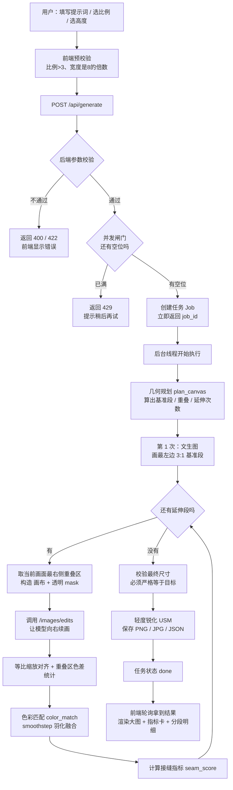
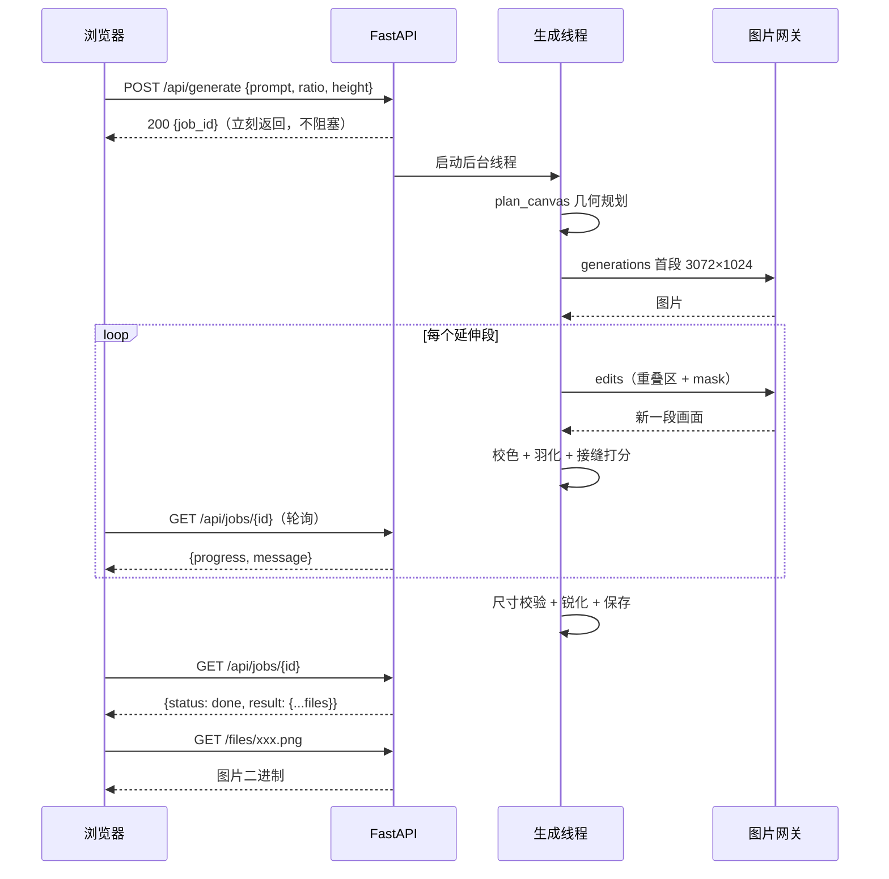

# 超宽全景生成 · 保姆级开发文档

> 题目：突破单次 3:1 宽高比限制，生成 6:1 / 8:1 超宽全景图
> 读者：0 基础也能照着做；每一步都给出「命令 → 预期结果 → 不对怎么办」
> 代码仓库：`https://gitee.com/zsl-wdk/wide-panorama.git`

---

## 0. 这份文档怎么用

### 0.1 你会得到什么

跟着做完，你会得到一个可以对外访问的在线 Demo：

- 输入一句画面描述，选择 6:1 / 8:1 / 12:1 或自定义宽度；
- 后端自动拆成多次「≤3:1 画布」的生成，再拼成一张完整的超宽图；
- 页面实时显示进度、输出尺寸、调用次数、单次最大画布比例、接缝指标；
- 支持下载 PNG / JPG / 元数据 JSON。

### 0.2 文档约定

| 记号 | 含义 |
|---|---|
| `命令` | 在终端里逐行输入并回车 |
| 预期结果 | 正常时应看到的输出；看不到就先看「不对怎么办」 |
| 💡 | 给 0 基础读者的补充解释，可以跳过 |
| ⚠️ | 容易踩坑的地方 |

> 本文主线用 **Windows + PowerShell**。CentOS 部署在[第 9 章](#9-部署到-centos-服务器)单独讲。

### 0.3 全流程总览

| 阶段 | 你要做的事 | 产物 | 验收方式 |
|---|---|---|---|
| 1. 理解题目 | 读第 1 章 | 知道题目到底考什么 | 能说出为什么不能拉伸 |
| 2. 看懂业务 | 读第 2 章 | 脑子里有一张流程图 | 能复述一次生成的 7 个步骤 |
| 3. 理解方案 | 读第 3 章 | 懂几何公式与融合原理 | 能手算 6:1 的调用次数 |
| 4. 准备环境 | 装 Python、建虚拟环境、装依赖 | 能 import 成功 | `python -c "import app.main"` 无报错 |
| 5. 本地跑通 | 用 mock 后端启动 | 浏览器能出图 | 6:1 输出 6144×1024 |
| 6. 接真实模型 | 填 Key、探测网关、生成 | 真实案例 PNG | 接缝指标 ≤2.5 |
| 7. 部署 | Docker → CentOS → 公网 | 公网 URL | 别人能打开并生成 |
| 8. 测试交付 | 自检 + 冒烟 + 手工验收 | 测试记录 | 全部 PASS |
| 9. 日常启动 | 读第 14 章 | 开机 → 开 VMware → 开浏览器 | 页面出现「后端就绪」 |

### 0.4 零基础操作扫盲（先看这 2 分钟）

💡 **怎么打开终端（PowerShell）**

- 方法一：按 `Win + R`，输入 `powershell`，回车；
- 方法二：在项目文件夹里，空白处按住 `Shift` 点右键，选「在终端中打开」。

💡 **怎么进入项目目录**

```powershell
cd C:\Users\你的用户名\Documents\wide-panorama
```

输入 `cd` 后按 `Tab` 可以自动补全路径。

💡 **怎么执行本文的命令**

把代码块里的命令整行复制，在 PowerShell 窗口里点右键（或 `Ctrl+V`）粘贴，回车。
看到命令前面出现新的提示符，说明执行完了。

💡 **怎么停止正在运行的服务**

在那个窗口按 `Ctrl+C`；或者直接关掉窗口。
服务没停就重复启动，会报「端口被占用」（解决办法见 5.5）。

💡 **路径里有空格怎么办**

用英文双引号包起来，例如：

```powershell
cd "C:\Users\张三\My Documents\wide-panorama"
```

💡 **看到「不是内部或外部命令」**

说明系统找不到这个程序，优先检查三件事：

1. 是不是拼写错了；
2. 是不是没装（比如 `python`、`docker`）；
3. 是不是当前目录不对（`dir` 看看有没有 `app` 文件夹）。

### 0.5 最短跑通路线（复制粘贴版）

只想先看到效果，按这 5 步：

```powershell
# 1. 进入项目目录（换成你自己的路径）
cd C:\Users\你的用户名\Documents\wide-panorama

# 2. 建虚拟环境
python -m venv .venv

# 3. 装依赖
.\.venv\Scripts\python.exe -m pip install -r requirements.txt

# 4. 准备配置（默认 mock，不花钱）
Copy-Item .env.example .env

# 5. 启动
.\.venv\Scripts\python.exe -m uvicorn app.main:app --host 127.0.0.1 --port 8000
```

浏览器打开 <http://127.0.0.1:8000>，选 6:1，点生成。
看到大图就算跑通。之后按第 6 章换成真实模型。

---

## 1. 题目解析

### 1.1 题目在说什么（大白话）

图片生成模型一次最多只能画 **3:1** 的画布（比如 3072×1024）。
题目要求你交出 **6:1、8:1 甚至更宽**的图，而且：

- 画面内容要连贯，主体、风格、光照、细节一致；
- **不能**把 3:1 的图横向拉长（拉伸）；
- **不能**先画大图再裁掉上下（裁切）；
- **不能**两边补纯色或模糊（留白）。

### 1.2 一句话翻译

> 既然一次画不下，那就**沿着已有画面的右边缘，让模型继续往右画**，画完再无缝拼起来。
> 这个技术在行业里叫 **outpainting（扩图 / 外绘）**。

### 1.3 逐条拆解评分点

| 题面要求 | 翻译成工程约束 | 本项目怎么实现 |
|---|---|---|
| 单次最大约 3:1 | 每次请求给模型的画布必须 ≤3:1 | `plan_canvas()` 计算每个画布宽度，`canvas_ratios` 全部 ≤3 |
| 最终比例 >3:1，至少 6:1 / 8:1 | 支持任意目标比例，最终宽度严格达标 | 基准段 + 若干延伸段，宽度累加恰好等于目标宽度 |
| 内容连贯 | 后一段必须"看到"前一段的右边缘 | 把旧图最右侧的重叠区作为上下文图传给 `images/edits` |
| 主体不重复 | 提示词明确"不要重复主体" | `build_prompts()` 的续画提示词里写死 `do not repeat the main subject` |
| 风格 / 光照 / 色调一致 | 提示词锚定 + 色彩统计对齐 | 提示词固定地平线/视角/光向；重叠区做 `color_match` |
| 不能有接缝 | 重叠区羽化融合 + 量化接缝指标 | `blend_overlap()` 用 smoothstep；`seam_score()` 打分 |
| 不能拉伸 / 裁切 / 留白 | 尺寸必须由模型真实生成 | 每段都 `resize_cover`（等比缩放+居中裁切），绝不 `resize` 到变形 |
| 交付代码 + Demo + 案例 + 说明 | 工程完整度 | FastAPI + 前端 + Docker + 案例 + 本文件 |

### 1.4 三种错误做法（题目明确禁止）

```
❌ 拉伸：3072×1024 ──横向拉──> 8192×1024     主体变胖、比例失真
❌ 裁切：先出 8192×2731，再裁成 8192×1024     上下内容丢失，且模型根本画不了 8K
❌ 留白：两侧补黑边/模糊/纯色                 一眼假，信息缺失
```

✅ 正确做法：**新增的每一块像素，都必须由模型基于上下文真实画出来。**

### 1.5 验收标准（先立靶子）

做完后逐条自查：

- [ ] 6:1 输出尺寸恰好是 `width × height`，宽高比 = 6.00
- [ ] 单次调用画布比例全部 ≤ 3.00（元数据里有 `max_single_call_ratio`）
- [ ] 接缝指标 `seam_score_max` ≤ 2.5（≈1 表示与周围纹理一致）
- [ ] 画面没有明显重复的灯塔/建筑/山峰
- [ ] 地平线在整张图里是**一条连续的线**
- [ ] 代码、Demo、案例、文档齐全，换台机器能跑起来

---

## 2. 业务流程图

> 这一章回答一个问题：**从用户点「生成」到看到图，系统里到底发生了什么？**
> 建议先看 2.1 的大白话，再看 2.2 的流程图。

### 2.1 用户视角（大白话版）

1. 我在页面里写一句「黄昏海岸线，灯塔，平静海面」，选 6:1，点生成。
2. 页面立刻告诉我「已提交」，然后进度条开始走：首段 → 延伸 1/2 → 延伸 2/2 → 校验 → 完成。
3. 后端先算好：这张 6144×1024 的图要分 3 次画，每次画布多宽、重叠多少。
4. 第 1 次：让模型画最左边 3072×1024（比例 3:1，正好卡在上限）。
5. 第 2 次：把第 1 次的**最右边 464px** 连同空白画布一起交给模型，说「照这个样子往右继续画 1536px」。
6. 第 3 次：再重复一次，又往右接 1536px。
7. 每次接完，后端做三件事：**校色 → 羽化 → 打分**；分数合格就继续，不合格也会记录下来。
8. 最后裁成精确的 6144×1024，轻度锐化，存成 PNG/JPG/JSON，前端刷新出大图。

### 2.2 总流程图



> 如果 Mermaid 在你的 Markdown 阅读器里不显示，看下面的纯文本版本。

### 2.3 纯文本流程图（任何地方都能看）

```
┌─────────────── 浏览器（前端） ───────────────┐
│ 1. 填提示词 / 选 6:1 / 选高度 768             │
│ 2. 预校验：比例>3、宽度 8 的倍数               │
│ 3. POST /api/generate  ────────────────┐      │
│ 6. 每 0.7s 轮询 /api/jobs/{id}  <──────┼──┐   │
│ 8. 渲染大图 / 指标卡 / 分段表格         │  │   │
└───────────────────────────────────────┼──┼───┘
                                        │  │
┌─────────────── FastAPI（后端） ────────▼──┴───┐
│ 4. 校验参数 → 抢并发名额 → 建任务 → 返回 job_id │
│    后台线程：                                  │
│    5. 几何规划 → 第1次文生图 → 循环续画         │
│       每段：取重叠区 → edits → 校色 → 羽化 → 打分│
│       最后：尺寸校验 → 锐化 → 落盘 → 状态 done │
└───────────────────────┬───────────────────────┘
                        │ HTTPS
              ┌─────────▼─────────┐
              │  图片网关（外部）   │
              │ generations / edits│
              └───────────────────┘
```

### 2.4 前后端时序图



### 2.5 每一步的输入输出

| 步骤 | 输入 | 处理 | 输出 |
|---|---|---|---|
| 提交 | 提示词、比例、高度、是否锐化 | 校验（比例>3、宽度 8 倍数、≤16384） | `job_id` 或 400/422/429 |
| 规划 | 目标比例或目标宽度、高度、上限 3 | `plan_canvas` | 基准宽、重叠、各次新增、调用次数 |
| 首段 | 提示词、基准尺寸 | `images/generations` | 3:1 基准图 |
| 续画 | 右边缘重叠区、新增宽度 | 拼画布 + 透明 mask → `images/edits` | 重叠 + 新增的一段图 |
| 校色 | 新段、旧图重叠区 | 只在重叠区估计均值/标准差 | 色温对齐后的新段 |
| 融合 | 画布、新段、重叠宽度 | smoothstep 权重渐变 | 更宽的新画布 |
| 打分 | 融合后的图、接缝位置 | 列梯度 / 邻域中位数 | 接缝指标（≈1 好） |
| 落盘 | 最终画布 | 尺寸校验 + USM 锐化 | PNG / JPG / JSON |
| 展示 | 任务结果 | 前端渲染 | 大图 + 指标 + 明细 |

### 2.6 业务说法 vs 技术名词

| 你嘴里的说法 | 代码里的名字 |
|---|---|
| 一次最多画 3:1 | `max_single_ratio = 3.0` |
| 分几次画 | `calls` / `extensions` |
| 两段接上时压住一部分 | `overlap`（重叠像素） |
| 让模型接着画 | `outpaint` / `images/edits` |
| 接缝看不出来 | `seam_score` ≈ 1 |
| 颜色不发灰不发蓝 | `color_shift`、`color_match` |
| 高清一点 | `sharpen`（USM 锐化） |
| 输出尺寸严格达标 | `size_ok` / `ratio_ok` |

### 2.7 失败路径（也要心里有数）

| 失败点 | 用户看到 | 排查方向 |
|---|---|---|
| 提示词为空 / 比例 ≤3 | 页面红字提示 | 改参数 |
| 同时生成的人太多 | 429「任务已满」 | 等一会儿，或调大 `MAX_CONCURRENT_JOBS` |
| Key 无效 / 余额不足 | 生成失败 + 网关错误文本 | 查 `.env`、查网关后台 |
| 网关不支持 edits | 自动退化为文生图 | 元数据 `mode` 会显示 `fallback-text` |
| 某段尺寸不对 | `输出尺寸异常` | 看日志与 `out` 尺寸，多为网关忽略 size |
| 接缝 >2.5 | 图上有明显竖线 | 增大重叠、改提示词、检查色差 |

---

## 3. 方案设计与公式推导

### 3.1 为什么是「横向分段续画」

- 题目限制的是**单次画布**，不是最终画面 → 可以多次生成再拼。
- 只往右接，不往上下接 → 拼接口最少，地平线最容易保持一条线。
- 每次都能看到上一段的右边缘 → 模型有足够上下文，主体不会凭空重画。

### 3.2 几何规划（最核心的 5 行公式）

设：段高 `H`，单次上限 `P = 3`，重叠 `o`，目标宽度 `W`。

```
基准段宽     = min(W, P·H)
单次最大新增 = P·H − o
延伸次数 n   = ceil((W − 3H) / (P·H − o))
第 i 次画布  = o + 新增_i ≤ P·H
最终宽度     = 基准段宽 + Σ新增_i = W
```

**为什么这样一定不超限？**
因为每次画布的宽度 = 重叠 + 新增，而新增被强制 ≤ `P·H − o`，所以画布 ≤ `P·H`，比例 ≤ `P`。

**为什么最终宽度一定等于 W？**
`n` 用向上取整保证次数够；然后把剩余宽度**均分**给各次新增，最后一次兜底补齐取整误差。代码在 `app/geometry.py` 的 `plan_canvas()`。

### 3.3 一个完整例子（H=1024，o=464）

| 目标 | 最终尺寸 | 基准段 | 各次新增 | 调用 | 每次画布比例 |
|---|---|---|---|---|---|
| 6:1 | 6144×1024 | 3072 | 1536 + 1536 | 3 | 1.95 |
| 8:1 | 8192×1024 | 3072 | 2560 + 2560 | 3 | 2.95 |
| 12:1 | 12288×1024 | 3072 | 2304 × 4 | 5 | 2.70 |

> 8:1 情况下每次画布 3024×1024 = 2.95:1，已经贴着上限，但**永远不越线**。

### 3.4 重叠为什么取 15%

| 重叠太小（<8%） | 重叠太大（>25%） |
|---|---|
| 模型看不到足够上下文，接缝处内容对不上 | 每次真正新增的宽度变少，调用次数和成本上升 |
| 色差估计样本不足 | 重叠区反复被重绘，细节可能糊 |

15% 是经验值：既能提供约 1/6 画面的上下文，又不至于浪费太多额度。
可以通过 `OVERLAP_FRAC` 调整，建议 0.12 ~ 0.20。

### 3.5 一致性四件套

1. **上下文图**：把旧图最右侧 `o` 像素作为 `image` 传给 `images/edits`，模型能"看见"要接什么。
2. **提示词锚定**：续画提示词固定写死 `same horizon height / camera perspective / scale / lighting direction / color grading / art style`，并明确 `do not repeat the main subject`。
3. **色彩对齐**：只统计**重叠区**的均值/标准差，把新段对齐到旧段；不要用整段统计，否则会把画面整体校偏。
4. **羽化融合**：重叠区用 smoothstep 权重（两端导数为 0），避免线性混合产生的"带状"过渡。

### 3.6 接缝指标怎么算、怎么读

```
接缝列梯度 = 接缝位置相邻几列的像素差的均值
邻域基准   = 接缝左右各 96 列（排除接缝带）梯度的中位数
指标       = 接缝列梯度 / 邻域基准
```

| 指标 | 含义 |
|---|---|
| ≈ 1.0 | 接缝处纹理密度与周围一致，肉眼基本看不出 |
| 1.5 ~ 2.5 | 需要放大才可能注意到，可接受 |
| > 2.5 | 明显竖线，通常是内容对不上或色差过大 |

> 用邻域中位数而不是全图中位数，是为了避免接缝恰好落在水面/草地等高纹理区域被误判。

### 3.7 目录结构与模块职责

```
wide-panorama/
├── app/
│   ├── config.py            # 读取 .env，集中所有参数
│   ├── geometry.py          # 比例解析 + 分窗规划（纯数学，最好测）
│   ├── imaging.py           # 缩放、校色、羽化、接缝指标、锐化
│   ├── pipeline.py          # 主流程编排：规划→生成→融合→落盘
│   ├── jobs.py              # 内存任务队列（进度/结果）
│   ├── main.py              # FastAPI 路由 + 并发闸门
│   └── providers/
│       ├── base.py          # Provider 抽象接口
│       ├── mock.py          # 离线程序化渲染（不花钱）
│       └── openai_compat.py # OpenAI 兼容网关（真实出图）
├── static/index.html        # 前端单页（无构建步骤）
├── scripts/
│   ├── selfcheck.py         # 离线自检：几何 + 端到端
│   ├── smoke_test.py        # 接口冒烟：错误码 + 可选真实生成
│   ├── probe_api.py         # 探测网关模型/尺寸/edits 支持
│   └── make_examples.py     # 批量生成案例
├── outputs/                 # 生成结果（PNG/JPG/JSON）
├── Dockerfile
├── docker-compose.yml
├── requirements.txt
├── run.ps1                  # Windows 一键启动
├── .env.example
└── docs/开发文档.md          # 本文件
```

---

## 4. 环境准备

> 本章只做一件事：让你的电脑具备运行本项目的条件。
> 全程约 10~20 分钟（取决于网速）。

### 4.1 软硬件清单

| 项目 | 最低 | 推荐 |
|---|---|---|
| 操作系统 | Windows 10 / 11 | Windows 11 |
| 内存 | 8 GB | 16 GB |
| 磁盘 | 2 GB 空闲 | 5 GB |
| Python | 3.10 | 3.12 |
| 网络 | 能访问图片网关 | 稳定宽带（每次生成 1~6 分钟） |

💡 **什么是 Python 虚拟环境（venv）？**
可以理解成一个"项目专用的小房间"：里面装的依赖只给这个项目用，不会污染系统 Python，也不会和别的项目打架。删掉 `.venv` 文件夹就等于把房间清空，随时可以重来。

### 4.2 安装 Python（Windows）

1. 打开 <https://www.python.org/downloads/windows/>，下载 **Python 3.12** 的 64 位安装包。
2. 双击安装，**务必勾选**：
   - [x] `Add python.exe to PATH`
   - [x] `Install launcher for all users`
3. 安装完成后，**新开一个 PowerShell 窗口**（旧窗口不会刷新 PATH），验证：

```powershell
python --version
```

预期：

```
Python 3.12.x
```

⚠️ 如果弹出 Microsoft Store 或提示找不到命令：说明 PATH 没配好。重新运行安装包，选 `Modify`，把 `Add to PATH` 打开；或者直接用 `py -3.12 --version`。

### 4.3 获取代码

已有仓库地址，直接克隆（需要先装 Git）：

```powershell
cd C:\Users\你的用户名\Documents
git clone https://gitee.com/zsl-wdk/wide-panorama.git
cd wide-panorama
```

没有 Git 也可以去 Gitee 页面点「克隆/下载 → 下载 ZIP」，解压后进入目录。

### 4.4 创建虚拟环境并安装依赖

```powershell
python -m venv .venv
.\.venv\Scripts\python.exe -m pip install --upgrade pip
.\.venv\Scripts\python.exe -m pip install -r requirements.txt
```

💡 这里用 `.\.venv\Scripts\python.exe` 直接调用，**不激活**虚拟环境，避免 PowerShell 的执行策略问题；效果和 `activate` 一样。

国内网络如果 pip 很慢：

```powershell
.\.venv\Scripts\python.exe -m pip install -r requirements.txt -i https://pypi.tuna.tsinghua.edu.cn/simple
```

验证依赖是否装好：

```powershell
.\.venv\Scripts\python.exe -c "import fastapi, uvicorn, PIL, numpy, requests; print('依赖 OK')"
```

预期：

```
依赖 OK
```

### 4.5 配置环境变量（.env）

```powershell
Copy-Item .env.example .env
notepad .env
```

`.env` 逐项说明：

| 变量 | 作用 | 本地演示 | 真实出图 |
|---|---|---|---|
| `IMAGE_PROVIDER` | 用哪个后端 | `mock` | `openai` |
| `IMAGE_API_BASE_URL` | 网关地址（到 `/v1` 为止） | 随便 | `https://www.cnxmai.com/v1` |
| `IMAGE_API_KEY` | 你的 Key | 留空 | `sk-...` |
| `IMAGE_MODEL` | 模型名 | 随便 | `gpt-image-1.5` |
| `MAX_SINGLE_RATIO` | 单次上限，题目是 3 | `3` | `3` |
| `OVERLAP_FRAC` | 重叠比例 | `0.15` | `0.15` |
| `DEFAULT_HEIGHT` | 页面默认高度 | `1024` | `1024` |
| `IMAGE_SIZE_MODE` | 尺寸策略 | `auto` | `auto` |
| `IMAGE_ENABLE_EDITS` | 是否用 edits 续画 | `1` | `1` |
| `REQUEST_TIMEOUT` | 单次请求超时（秒） | `300` | `300` |
| `MAX_CONCURRENT_JOBS` | 同时生成任务数 | `1~2` | `1~2` |

⚠️ `.env` 里有密钥，**不要提交到 Git**。仓库的 `.gitignore` 已经排除它；公网部署前建议轮换 Key。

### 4.6 验证项目能加载

```powershell
.\.venv\Scripts\python.exe -c "import app.main; print('项目加载 OK')"
```

预期：

```
项目加载 OK
```

### 4.7 常见问题

| 现象 | 原因 | 解决 |
|---|---|---|
| `python` 打开应用商店 | PATH 未生效 | 重装勾选 Add to PATH，或 `py -3.12` |
| `pip` 超时 | 网络 | 换清华源 |
| `ModuleNotFoundError: app` | 不在项目根目录 | `cd` 到 `wide-panorama`（有 `app/` 的那层） |
| 端口 8000 被占用 | 旧服务没关 | 见第 5.5 节 |
| 杀毒软件拦 Python | 误报 | 允许运行 |

---

## 5. 本地跑通（Mock 离线后端）

> 先用不花钱的 mock 验证整条链路，确认"几何、拼接、进度、页面"都没问题，再去接真实模型。

### 5.1 mock 是什么、不是什么

- ✅ 它按"世界坐标"程序化渲染同一幅全景的不同窗口，所以只要拼接几何正确，接缝天然连续；
- ✅ 它能验证：分窗公式、重叠融合、接缝指标、任务进度、前端渲染；
- ❌ 它不是 AI 生图，画面是代码画出来的，**不能拿去当题目交付案例**。

### 5.2 启动

确认 `.env` 里 `IMAGE_PROVIDER=mock`，然后：

```powershell
.\.venv\Scripts\python.exe -m uvicorn app.main:app --host 127.0.0.1 --port 8000
```

预期：

```
INFO:     Started server process [xxxx]
INFO:     Application startup complete.
INFO:     Uvicorn running on http://127.0.0.1:8000 (Press CTRL+C to quit)
```

也可以直接用仓库里的脚本：

```powershell
.\run.ps1 -Port 8000 -Provider mock
```

### 5.3 打开页面并操作

1. 浏览器访问 <http://127.0.0.1:8000>；
2. 右上角徽标应显示「后端就绪 · mock」；
3. 点示例「海岸灯塔」，或自己写一句描述；
4. 比例选 `6:1`，高度 `1024`，勾选「高清增强」；
5. 点「生成超宽全景」。

### 5.4 预期结果

- 进度条很快走完（mock 通常 5~20 秒）；
- 预览区出现一张很宽的全景图（占据页面主要面积）；
- 指标卡显示：输出尺寸 `6144×1024`、实际比例 `6.00:1`、生成调用 `3 次`、单次最大画布 `1.95:1`、接缝指标约 `1.5`；
- 「分段生成明细」里能看到 3 行，第 2、3 行是 `outpaint` 模式；
- 点「全屏查看」可以铺满屏幕，点「1:1 原始尺寸」可以拖动查看细节。

### 5.5 端口被占用怎么办

```powershell
Get-NetTCPConnection -State Listen -LocalPort 8000 | Select-Object LocalPort,OwningProcess
Stop-Process -Id <OwningProcess> -Force
```

或者换个端口启动：

```powershell
.\.venv\Scripts\python.exe -m uvicorn app.main:app --port 8001
```

### 5.6 离线自检（强烈建议先跑）

```powershell
.\.venv\Scripts\python.exe scripts\selfcheck.py
```

预期输出（数值可能略有差异）：

```
[1] 分窗几何
    4:1 -> 4096x1024，基准 3072px，延伸 [1024]，重叠 464px，调用 2 次，画布比例 [1.45]
    6:1 -> 6144x1024，基准 3072px，延伸 [1536, 1536]，重叠 464px，调用 3 次，画布比例 [1.95, 1.95]
    8:1 -> 8192x1024，基准 3072px，延伸 [2560, 2560]，重叠 464px，调用 3 次，画布比例 [2.95, 2.95]
    12:1 -> 12288x1024，基准 3072px，延伸 [2304, 2304, 2304, 2304]，重叠 464px，调用 5 次，画布比例 [2.7, 2.7, 2.7, 2.7]
    指定宽度 4992x1024 -> ...

[2] 端到端（Mock 后端）
    6:1: 4608x768，比例 6.00，调用 3 次，最大接缝 1.5x ...
    8:1: 6144x768，比例 8.00，调用 3 次，最大接缝 1.5x ...

全部自检通过。
```

> 注意：12:1 的延伸次数会随高度/重叠略有变化，以实际输出为准；断言保证的是「尺寸达标 + 每次≤3:1」。

### 5.7 排错

| 现象 | 原因 | 解决 |
|---|---|---|
| 页面一直「正在检查后端」 | 服务没起来 | 看终端报错 |
| 点生成一直 0% | 线程异常 | 看终端 traceback |
| 预览空白 | 图片没生成 | 检查 `outputs/` 是否有文件 |
| 429 | 并发名额被占满 | 重启服务，或调大 `MAX_CONCURRENT_JOBS` |

---

## 6. 接入真实模型

### 6.1 准备 Key 与网关

你需要两样东西：

- **API Key**：形如 `sk-...`；
- **Base URL**：到 `/v1` 为止，例如 `https://www.cnxmai.com/v1`。

### 6.2 先探测网关能力（可选但推荐）

```powershell
.\.venv\Scripts\python.exe scripts\probe_api.py --matrix --model gpt-image-1.5
```

它会：

1. 列出模型；
2. 依次试 `1024x1024`、`1536x1024`、`2000x1024`、`3072x1024`；
3. 试一次 `/images/edits`。

重点看两件事：

- `generations` 是否 200；
- `edits` 是否 200（决定能不能用质量最好的续画方式）。

⚠️ 很多网关会限制单次像素数（例如约 **1.57MP**）：你请求 `2000×1024`，它可能回 `1752×897`（比例一致、尺寸变小）。
本项目用 `resize_cover()` 等比放大回目标尺寸，**不会拉伸**；再用 USM 锐化补偿一点清晰度。

### 6.3 写入 .env

```ini
IMAGE_PROVIDER=openai
IMAGE_API_BASE_URL=https://www.cnxmai.com/v1
IMAGE_API_KEY=sk-你的新Key
IMAGE_MODEL=gpt-image-1.5
IMAGE_ENABLE_EDITS=1
MAX_CONCURRENT_JOBS=1
```

改完**必须重启服务**（配置只在启动时读取一次）。

```powershell
# Ctrl+C 停掉旧服务，再启动
.\.venv\Scripts\python.exe -m uvicorn app.main:app --host 127.0.0.1 --port 8000
```

验证：

```powershell
curl.exe -s http://127.0.0.1:8000/api/health
```

预期：

```json
{"ok":true,"provider":"openai-compatible","demo_mode":false,"api_configured":true,"max_single_ratio":3.0,"default_height":1024}
```

### 6.4 第一次真实生成

浏览器里选 `6:1`、高度 `1024`，点生成。
一次 6:1 约 2~6 分钟（取决于网关排队），请耐心等进度条。

完成后检查：

- 指标卡「单次最大画布」≤ 3.00；
- 「最大接缝指标」≤ 2.5；
- 打开「分段生成明细」，第 2/3 段 `mode` 应为 `edits`（若显示 `fallback-text` 说明网关不支持 edits，已自动降级）。

### 6.5 参数怎么调

| 想要 | 怎么调 | 代价 |
|---|---|---|
| 更快 | 高度 768 → 512 | 分辨率降低 |
| 更清晰 | 高度 768（接近网关原生像素） | 输出尺寸变小 |
| 更大尺寸 | 高度 1024 + 比例 8:1 | 调用次数/耗时增加 |
| 接缝更好 | `OVERLAP_FRAC` 0.15 → 0.18 | 每段新增变少，调用可能增加 |
| 画面更锐 | 勾选「高清增强」 | 轻微锐化，不会改变几何 |

💡 一个反直觉的点：**高度不是越大越清晰**。
网关会把超过约 1.57MP 的画布先缩小再返回，你请求 3072×1024（3.1MP）会先被压到约 1.57MP，再被本项目放回 3072×1024 —— 等于"降采样再放大"。
高度 768 时，基准画布 2304×768（1.77MP）更接近网关原生像素，单位像素更"实"。

### 6.6 常见错误码

| 状态 / 报错 | 含义 | 解决 |
|---|---|---|
| 401 / 403 | Key 无效或无权限 | 检查 Key、模型名 |
| 429（网关） | 请求太频繁 | 降低并发、重试 |
| 400 size 相关 | 网关不接受该尺寸 | 设 `IMAGE_SIZE_MODE=preset` |
| `edits 404` | 网关没有 edits 接口 | 设 `IMAGE_ENABLE_EDITS=0`，退化为文生图 |
| `接口未返回图片` | 返回结构不兼容 | 用 `probe_api.py` 看原始响应 |
| 超时 | 网关排队太久 | 调大 `REQUEST_TIMEOUT` |

---

## 7. 代码实现逐文件讲解

> 这一章不要求你背代码，只要求你知道**每个文件负责什么、改哪里会影响什么**。

### 7.1 `app/geometry.py`：只做数学，最好测试

核心函数 `plan_canvas(target_ratio, height, max_single_ratio, overlap_frac, width=None)`：

- 输入：目标比例或目标宽度、高度；
- 输出 `Plan`：`width / height / base_width / overlap / extensions / canvas_ratios`；
- 所有尺寸对齐到 8 的倍数（多数图片接口的要求）；
- 指定 `width` 时精确使用，不再按比例反算。

验证：跑 `scripts/selfcheck.py` 的第 `[1]` 段。

### 7.2 `app/imaging.py`：像素级工具

| 函数 | 作用 | 关键点 |
|---|---|---|
| `resize_cover` | 等比缩放后居中裁切 | 绝不拉伸；aspect 一致时不会裁掉内容 |
| `color_match` | 对齐均值/标准差 | 续画时只用重叠区估计 |
| `blend_overlap` | 重叠区融合 | smoothstep，两端导数为 0 |
| `seam_score` | 接缝打分 | 邻域中位数做基准 |
| `color_shift` | 重叠区色差 | 融合前先量化 |
| `sharpen_image` | USM 轻度锐化 | radius 1.2 / percent 45 / threshold 3 |

### 7.3 `app/providers/`：把"模型"抽象成一个接口

`base.py` 定义：

```python
class ImageProvider:
    def text_to_image(self, ctx, width, height) -> Image.Image: ...
    def outpaint(self, ctx, context, width, height, overlap) -> Image.Image: ...
```

- `mock.py`：程序化渲染，零成本；
- `openai_compat.py`：调 `/images/generations` 和 `/images/edits`；
  - `support_outpaint=True`；
  - edits 失败会自动降级到 `fallback-text`，保证 Demo 不中断；
  - 元数据记录 `mode / size / canvas / out`（`out` 是网关实际回传尺寸，排错很有用）。

### 7.4 `app/pipeline.py`：总导演

`generate_panorama()` 的顺序：

1. `plan_canvas` 规划；
2. 首段 `text_to_image`；
3. `for` 每个延伸段：
   - 取当前画布右边缘 `overlap` 像素作为窗口；
   - `provider.outpaint(...)`；
   - `resize_cover`；
   - `color_shift` 量化色差；
   - `color_match` 校色；
   - `blend_overlap` 融合；
   - `seam_score` 打分；
4. 校验最终宽高；
5. `sharpen_image`；
6. `_save_outputs` 写 PNG/JPG/JSON；
7. 通过 `on_progress` 回调更新任务进度。

### 7.5 `app/jobs.py` + `app/main.py`：接口层

- `JobStore`：内存字典 + 线程锁，保存进度/结果；最多 200 条，满了删最旧的已完成任务；
- `create_job`：参数校验 → 抢并发名额（`BoundedSemaphore`）→ 建任务 → 起线程 → 立刻返回 `job_id`；
- 校验规则：提示词 1~800 字；高度 256~2048；宽度 64~16384 且 8 的倍数；比例必须 >3；总宽 ≤16384；
- 并发满返回 **429**，避免公网被连点打爆额度。

### 7.6 `static/index.html`：无构建单页

- 深色两栏：左侧参数面板，右侧大预览；
- 预览区高度 `clamp(440px, 68vh, 880px)`，并提供「适应窗口 / 1:1 / 全屏」三种查看方式；
- 提交后每 0.7s 轮询任务，渲染大图 + 6 个指标卡 + 分段明细；
- 「高清增强」对应 `sharpen=true`；「目标宽度」可绕过比例直接指定像素宽。

---

## 8. 用 Docker 部署（本机）

### 8.1 安装 Docker Desktop

1. 下载 <https://www.docker.com/products/docker-desktop/>；
2. 安装后启动，等到鲸鱼图标变绿；
3. 验证：

```powershell
docker --version
docker compose version
```

### 8.2 构建并启动

在项目根目录：

```powershell
docker compose down --remove-orphans
docker compose up -d --build
```

⚠️ 如果之前建过同名容器，会报 `Conflict. The container name "/wide-panorama" is already in use`。
**先执行 `docker compose down --remove-orphans` 再构建**，这是本项目的标准姿势。

预期：

```powershell
docker compose ps
```

```
NAME             IMAGE                   STATUS                   PORTS
wide-panorama    wide-panorama:latest    Up (healthy)             0.0.0.0:8000->8000/tcp
```

验证：

```powershell
curl.exe -s http://127.0.0.1:8000/api/health
```

### 8.3 数据与配置

- `outputs/` 挂载到宿主机，容器重建不丢案例；
- `.env` 通过 `env_file` 注入，**不要把 Key 写进 Dockerfile**；
- 改 `.env` 后需要 `docker compose up -d` 重建容器才生效。

### 8.4 常用命令

```powershell
docker compose logs -f --tail=100   # 看日志
docker compose restart              # 重启
docker compose down                 # 停止并删除容器
docker compose up -d --build        # 改代码后重建
```

---

## 9. 部署到 CentOS 服务器

> 以 root 登录为例，示例服务器 IP：`192.168.88.101`。

### 9.1 先确认系统

```bash
cat /etc/centos-release
uname -m
```

预期：`CentOS Stream 8/9` 或 `CentOS Linux 7`，`x86_64`。

⚠️ CentOS 7 已于 2024 年停止维护，软件源可能 404。能换系统就换；不能换就用下面的 `--nogpgcheck` 或改用 Podman。

### 9.2 安装 Docker（dnf）

```bash
dnf install -y dnf-plugins-core
dnf config-manager --add-repo https://download.docker.com/linux/centos/docker-ce.repo
dnf install -y --nogpgcheck docker-ce docker-ce-cli containerd.io docker-buildx-plugin docker-compose-plugin
systemctl enable --now docker
docker version
docker compose version
```

⚠️ 如果 GPG 校验 404（CentOS 源已停），`--nogpgcheck` 可以绕过；这是本项目在旧镜像上实际用过的做法。

如果实在装不上 Docker，可以用 Podman 兼容：

```bash
dnf install -y podman podman-docker
podman --version
```

### 9.3 把代码放到服务器

方式 A：Git（推荐，后续更新方便）

```bash
dnf install -y git
cd /opt
git clone https://gitee.com/zsl-wdk/wide-panorama.git
cd wide-panorama
```

方式 B：从 Windows 上传

```powershell
scp -r .\wide-panorama root@192.168.88.101:/opt/
```

⚠️ 不要用 PowerShell 的 `Compress-Archive` 打包再上传：它可能写入反斜杠路径，Linux 解压后目录结构会坏。要用压缩包就用 Python 的 `zipfile`（正斜杠）。

### 9.4 配置并启动

```bash
cd /opt/wide-panorama
cp .env.example .env
vi .env        # 填 provider / base url / key / model
docker compose down --remove-orphans
docker compose up -d --build
docker compose ps
curl -s http://127.0.0.1:8000/api/health
```

预期最后一行：

```json
{"ok":true,"provider":"openai-compatible","demo_mode":false,"api_configured":true,...}
```

### 9.5 放行端口（可选）

```bash
firewall-cmd --add-port=8000/tcp --permanent
firewall-cmd --reload
```

同局域网的其他电脑访问 `http://192.168.88.101:8000`。

### 9.6 常见故障

| 现象 | 原因 | 解决 |
|---|---|---|
| `container name already in use` | 旧容器残留 | `docker compose down --remove-orphans` |
| `port is already allocated` | 8000 被占 | `ss -lntp \| grep 8000`，杀掉或改端口 |
| `Cannot connect to the Docker daemon` | 服务没启动 | `systemctl start docker` |
| `no space left on device` | 镜像/日志占满 | `docker system prune -af` |
| 页面能开但生成失败 | `.env` 没配 / 容器未重启 | `docker compose logs -f` |
| 时间显示不对 | 容器时区 UTC | `environment: TZ: Asia/Shanghai` |

---

## 10. 公网访问（Cloudflare 临时隧道）

> 目的：让不在同一局域网的人也能打开 Demo。**临时隧道免费、无需域名，但地址会变。**

### 10.1 在服务器上运行

```bash
curl -L -o cloudflared https://github.com/cloudflare/cloudflared/releases/latest/download/cloudflared-linux-amd64
chmod +x cloudflared
mv cloudflared /usr/local/bin/
cloudflared tunnel --url http://127.0.0.1:8000 --protocol http2 --no-autoupdate
```

终端会打印类似：

```
https://operation-fun-sean-cups.trycloudflare.com
```

把这个地址发给别人即可。

⚠️ 国内网络访问 GitHub 下载可能很慢；可先下载到本地再 `scp` 上传。

### 10.2 Windows 本机也能做

```powershell
curl.exe -L -o cloudflared.exe https://github.com/cloudflare/cloudflared/releases/latest/download/cloudflared-windows-amd64.exe
.\cloudflared.exe tunnel --url http://127.0.0.1:8000 --protocol http2 --no-autoupdate
```

### 10.3 注意事项

| 事项 | 说明 |
|---|---|
| 地址有效期 | 进程活着就有效；关掉终端就失效 |
| 不要关窗口 | 建议用 `tmux` / `nohup` / systemd 保活 |
| 安全 | 默认没有登录和限流，任何人都能提交生成、消耗你的额度 |
| 建议 | 演示前再开；演示后关闭；轮换 Key；`MAX_CONCURRENT_JOBS=1` |

保活示例（简单版）：

```bash
nohup cloudflared tunnel --url http://127.0.0.1:8000 --protocol http2 --no-autoupdate > /var/log/cloudflared.log 2>&1 &
tail -f /var/log/cloudflared.log
```

---

## 11. 测试与验收

### 11.1 离线自检（不依赖外部 API）

```powershell
.\.venv\Scripts\python.exe scripts\selfcheck.py
```

覆盖：

- 4:1 / 6:1 / 8:1 / 12:1 的分窗几何；
- 指定宽度 4992 的精确性；
- 每次画布比例 ≤3；
- mock 端到端尺寸与接缝。

### 11.2 接口冒烟测试

先启动服务，再跑：

```powershell
.\.venv\Scripts\python.exe scripts\smoke_test.py
```

预期全部 PASS：

```
[PASS] health
[PASS] POST /api/generate -> 422
[PASS] POST /api/generate -> 400   # 2:1
[PASS] POST /api/generate -> 400   # abc
[PASS] POST /api/generate -> 400   # 宽度 6143
[PASS] POST /api/generate -> 400   # 3072@1024 = 3:1
[PASS] POST /api/generate -> 400   # 16:1@1536 超宽
[PASS] GET /api/jobs/not-exist -> 404
[PASS] GET /files/..%2F.env -> 404
```

加一次真实生成（会花钱）：

```powershell
.\.venv\Scripts\python.exe scripts\smoke_test.py --generate
```

### 11.3 已完成的真实案例

| 场景 | 输出 | 调用 | 最大接缝 | 耗时 | 备注 |
|---|---|---|---|---|---|
| 海岸灯塔 6:1 | 6144×1024 | 3 | 0.97 | 133s | `outputs/case_6x1x1.png` |
| 海岸灯塔 8:1 | 8192×1024 | 3 | 1.40 | 85s | `outputs/case_8x1x1.png` |
| 海岸灯塔 6:1（高度 768） | 4608×768 | 3 | 1.28 | 362s | 单位像素更实 |

> 接缝指标 ≈1 说明接缝处纹理与周围一致。三张图在正常缩放下均看不到竖线。

### 11.4 手工验收清单

- [ ] 6:1 输出 6144×1024，比例 6.00
- [ ] 8:1 输出 8192×1024，比例 8.00
- [ ] 每段明细里 `画布宽度 / 高度 ≤ 3`
- [ ] 接缝指标 ≤2.5
- [ ] 放大到 1:1 也看不到明显竖线
- [ ] 主体（灯塔）只出现一次
- [ ] 地平线连续
- [ ] 下载 PNG 能打开，EXIF 尺寸正确
- [ ] 刷新页面后能重新生成，不报 500
- [ ] 并发提交第二次会得到 429（当 `MAX_CONCURRENT_JOBS=1`）

### 11.5 并发与稳定性

```powershell
# 临时把并发设为 1
$env:MAX_CONCURRENT_JOBS=1
.\.venv\Scripts\python.exe -m uvicorn app.main:app --port 8000
```

同时开两个浏览器提交：第二个应得到：

```json
{"detail":"当前生成任务已满（最多 1 个并发），请稍后重试"}
```

---

## 12. 交付清单

| 类别 | 内容 | 位置 |
|---|---|---|
| 代码 | FastAPI 后端 + 单页前端 | `app/`、`static/` |
| 原理 | 题目拆解、公式、融合策略 | 本文件第 1~3 章、`README.md` |
| 案例 | 6:1 / 8:1 真实生成图 + 元数据 | `outputs/` |
| Demo | 本地 + Docker + CentOS + 公网 | 第 5、8、9、10 章 |
| 测试 | 自检 + 冒烟 + 手工清单 | `scripts/`、第 11 章 |
| 部署 | Dockerfile / compose / 环境变量模板 | 根目录 |
| 文档 | 保姆级开发文档（本文件） | `docs/开发文档.md` |

---

## 13. FAQ

**Q1：为什么不直接找一个能出 8:1 的模型？**
题目限制的是单次画布能力，更换模型属于"绕过题目"，且大多数商用模型都有比例上限。分段续画才是通用解。

**Q2：为什么每次都要重新调用，不能一次生成完再拼？**
一次画不了 8:1，模型输出不了那么宽的画布；必须多次。

**Q3：接缝指标 2.0 就一定难看吗？**
不一定，它衡量的是"接缝列梯度相对邻域的倍数"。水面、雪地等低纹理区指标可能偏高但肉眼无感；最终以 1:1 放大目视为准。

**Q4：为什么真实图看起来有点"软"？**
网关会把超过约 1.57MP 的画布缩小后再返回，本项目再等比放大回目标尺寸，等于"降采样再放大"。已用 USM 锐化补偿；想要更实，把高度降到 768。

**Q5：生成一次要多久？**
mock 几秒；真实 6:1 约 2~6 分钟，主要耗在网关排队和三次调用。

**Q6：能生成 20:1 吗？**
理论上可以，但宽度上限 16384；高度 1024 时最多约 16:1，超过会被 400 拦截。

**Q7：可以把 Key 写进前端吗？**
绝对不行。Key 只放服务端 `.env`，前端只调本项目接口。

**Q8：公网 Demo 需要加登录吗？**
演示场景建议至少加访问口令或限流；当前版本用并发闸门 + 临时隧道来控制风险。

---

## 附录 A：命令速查

```powershell
# 环境
python -m venv .venv
.\.venv\Scripts\python.exe -m pip install -r requirements.txt

# 启动（mock）
.\run.ps1 -Port 8000 -Provider mock

# 启动（真实）
.\.venv\Scripts\python.exe -m uvicorn app.main:app --host 127.0.0.1 --port 8000

# 自检 / 冒烟
.\.venv\Scripts\python.exe scripts\selfcheck.py
.\.venv\Scripts\python.exe scripts\smoke_test.py
.\.venv\Scripts\python.exe scripts\smoke_test.py --generate

# Docker
docker compose down --remove-orphans
docker compose up -d --build
docker compose ps
docker compose logs -f --tail=100

# 端口排查
Get-NetTCPConnection -State Listen -LocalPort 8000 | Select-Object LocalPort,OwningProcess
```

## 附录 B：接口速查

| 方法 | 路径 | 说明 |
|---|---|---|
| GET | `/api/health` | 健康检查（provider / 是否配置 Key） |
| POST | `/api/generate` | 提交任务，返回 `job_id` |
| GET | `/api/jobs/{job_id}` | 查询进度 / 结果 |
| GET | `/files/{name}` | 下载输出文件 |
| GET | `/` | 前端页面 |

提交示例：

```json
{
  "prompt": "黄昏海岸线，灯塔，平静海面，电影感",
  "ratio": "6:1",
  "height": 1024,
  "sharpen": true
}
```

指定精确宽度：

```json
{
  "prompt": "雪山草甸，清晨薄雾",
  "width": 6144,
  "height": 1024,
  "sharpen": true
}
```

## 附录 C：指标口径

| 指标 | 计算 | 合格线 |
|---|---|---|
| `max_single_call_ratio` | 每次画布宽/高取最大 | ≤3.00 |
| `seam_score_max` | 接缝列梯度 / 邻域中位数，取最大 | ≤2.5（≈1 最佳） |
| `color_shift_max` | 重叠区两侧像素平均绝对差（0~255） | 越小越好，<10 可接受 |
| `size_ok` | 输出宽高严格等于规划 | `true` |
| `ratio_ok` | 最终比例 >3 | `true` |

## 附录 D：报错对照表

| 报错文本 | 可能原因 | 处理 |
|---|---|---|
| `提示词不能为空` | 传了空字符串 | 前端补校验 |
| `目标宽高比必须大于 3:1` | 选了 3:1 或 2:1 | 改比例 |
| `目标宽度需为 8 的倍数` | 手填宽度不对 | 改成 8 倍数 |
| `目标宽度过大` | >16384 | 降高度或比例 |
| `输出尺寸异常` | 网关返回尺寸异常 | 看元数据 `out`，检查 `size_mode` |
| `edits 404` | 网关不支持 edits | `IMAGE_ENABLE_EDITS=0` |
| `任务不存在` | job_id 过期/服务重启 | 重新提交 |
| `[Errno 10048]` | 端口被占 | 换端口或杀进程 |

---

## 14. 项目启动文档（下次开机照着做）

> 这一节是给"明天早上开电脑、要给别人演示"用的。
> 不用看前面任何章节，从上往下照着点一遍即可。

### 14.1 一页纸总览

| 顺序 | 要打开的软件 / 窗口 | 干什么 | 大约耗时 |
|---|---|---|---|
| 1 | **VMware Workstation** | 启动 `centos9_101` 虚拟机 | 1~2 分钟 |
| 2 | **VMware 里的终端**（或 MobaXterm / Xshell） | 检查 Docker 与隧道是否自启 | 1 分钟 |
| 3 | **浏览器** | 打开 Demo 地址，生成一张图验证 | 2~5 分钟 |

只有三样。**不需要**手动启动 Python、不需要手动跑 `docker compose`、不需要手动开隧道 —— 这三件事都已经做成开机自启。

> 当前部署速查：
> - 虚拟机：`centos9_101`，IP `192.168.88.101`，账号 `root`（密码用你自己的记录，本文不写明文密码）
> - 项目目录：`/root/wide-panorama`
> - 容器：`wide-panorama`（重启策略 `unless-stopped`，Docker 已 `enabled`）
> - 隧道服务：`cloudflared-quick.service`（`enabled` + `Restart=always`）
> - 局域网地址：`http://192.168.88.101:8000`
> - 公网地址：每次重启会变，用 14.4 的命令重新取

### 14.2 第一步：启动虚拟机

**怎么做（图形界面，推荐）**

1. 双击桌面上的 **VMware Workstation** 图标（已安装路径：`C:\smmDownload\SoftBH\VMware\vmware.exe`）。
2. 在左侧「库」里找到虚拟机 **centos9_101**（文件位置：`C:\vm_xvnij\rag&agent阶段配套虚拟机\centos9_101\centos9_101.vmx`）。
3. 点 **开启此虚拟机**（绿色三角）。
4. 看到登录界面后，输入：
   - 用户名 `root`
   - 密码：输入你自己的 root 密码（输入时屏幕不显示字符，是正常的，输完直接回车）
5. 登录成功后出现 `[root@centos9101 ~]#`，说明虚拟机好了。

**怎么做（命令行，不想点鼠标）**

```powershell
& "C:\smmDownload\SoftBH\VMware\vmrun.exe" start "C:\vm_xvnij\rag&agent阶段配套虚拟机\centos9_101\centos9_101.vmx"
& "C:\smmDownload\SoftBH\VMware\vmrun.exe" list
```

预期第二条命令输出：

```
Total running VMs: 1
C:\vm_xvnij\rag&agent阶段配套虚拟机\centos9_101\centos9_101.vmx
```

> 💡 路径里有 `&` 和中文，**必须整段用英文双引号包住**，否则 PowerShell 会报错。

**确认虚拟机网络通了**

在 Windows 的 PowerShell 里执行：

```powershell
Test-NetConnection -ComputerName 192.168.88.101 -Port 22 -InformationLevel Quiet
```

预期：

```
True
```

> ⚠️ **不对怎么办**
> - 输出 `False`：虚拟机可能还在开机。等 30 秒再试。
> - 报「该虚拟机似乎正在使用中」或提示 `.lck` 锁定文件：说明上次是非正常关机。到虚拟机目录 `C:\vm_xvnij\rag&agent阶段配套虚拟机\centos9_101\` 下，把名字带 `.lck` 的**文件夹**删掉，再启动。
> - 网络一直不通：在 VMware 里点「编辑 → 虚拟网络编辑器」，确认 NAT 网段是 `192.168.88.0/24`。

### 14.3 第二步：检查容器与隧道（在虚拟机里执行）

在虚拟机的终端里，依次执行下面 3 条命令。

**① 看容器起来了没**

```bash
docker ps --filter name=wide-panorama
```

预期（`STATUS` 里要有 `Up ... (healthy)`）：

```
CONTAINER ID   IMAGE                STATUS                   PORTS
xxxxxxxxxxxx   wide-panorama        Up 2 minutes (healthy)   0.0.0.0:8000->8000/tcp
```

**② 看公网隧道服务起来了没**

```bash
systemctl is-active cloudflared-quick
```

预期：

```
active
```

**③ 直接问一下服务本身**

```bash
curl -s http://127.0.0.1:8000/api/health
```

预期：

```json
{"ok":true,"provider":"openai-compatible","demo_mode":false,"api_configured":true,"max_single_ratio":3.0,"default_height":1024}
```

> 三个都正常 → 直接跳到 14.4。
> 有一个不正常 → 看下面「万一没自启」。

**万一没自启（手动拉起，三条命令）**

```bash
systemctl start docker                    # Docker 没起
cd /root/wide-panorama && docker compose up -d     # 容器没起
systemctl restart cloudflared-quick       # 隧道没起
```

再看一次状态：

```bash
docker ps --filter name=wide-panorama
systemctl is-active cloudflared-quick
```

> ⚠️ 如果 `docker compose up -d` 报 `Conflict. The container name "/wide-panorama" is already in use`：
>
> ```bash
> cd /root/wide-panorama
> docker compose down --remove-orphans
> docker compose up -d
> ```

### 14.4 第三步：拿到今天的公网地址

> Cloudflare 的**临时隧道每次重启都会换一个新地址**，昨天发给别人的链接今天大概率失效。所以每天演示前都要重新取一次。

在虚拟机终端执行：

```bash
journalctl -u cloudflared-quick --no-pager | grep -oE 'https://[a-z0-9-]+\.trycloudflare\.com' | tail -3
```

预期输出（最后一行就是今天可用的地址）：

```
https://operation-fun-sean-cups.trycloudflare.com
```

拿这个地址在 Windows 上验证一下：

```powershell
curl.exe -s -m 20 https://operation-fun-sean-cups.trycloudflare.com/api/health
```

预期返回和 14.3 ③ 一样的 JSON。

> ⚠️ **不对怎么办**
> - 输出为空：隧道刚起来还没打印地址，等 10 秒再执行一次。
> - 返回 502 / 连接被拒：容器没起来，回到 14.3。
> - 返回 `HTTP ERROR 530`：隧道断了，执行 `systemctl restart cloudflared-quick`，等 15 秒后重新取地址。

### 14.5 第四步：打开浏览器，跑一次冒烟

1. 打开 **Chrome / Edge**。
2. 地址栏输入（二选一）：
   - 同局域网、只有自己能看：`http://192.168.88.101:8000`
   - 要给别人看：14.4 拿到的 `https://xxxx.trycloudflare.com`
3. 页面右上角徽标应显示 **「后端就绪 · openai-compatible」**。
4. 左侧点示例「海岸灯塔」→ 比例选 **6:1** → 高度 **768** → 勾选「高清增强」→ 点「生成超宽全景」。
5. 进度条会走：`生成首段画面` → `向外延伸 1/2` → `向外延伸 2/2` → `完成`（约 2~6 分钟）。
6. 右侧大图出来后，检查指标卡：
   - 输出尺寸 = `4608×768`
   - 实际比例 = `6.00:1`
   - 生成调用 = `3 次`
   - 单次最大画布 ≤ `3.00:1`
   - 最大接缝指标 ≤ `2.5`

> 这一步跑通，就说明今天可以放心演示了。
> 如果只想快速确认服务活着、不想花额度，跳过第 4 步，只要徽标显示「后端就绪」即可。

### 14.6 每天开机后的检查清单（可打印）

- [ ] VMware 里的 `centos9_101` 已开机，能登录 root
- [ ] `Test-NetConnection 192.168.88.101 -Port 22` 返回 `True`
- [ ] `docker ps --filter name=wide-panorama` 显示 `Up (healthy)`
- [ ] `systemctl is-active cloudflared-quick` 返回 `active`
- [ ] `curl -s http://127.0.0.1:8000/api/health` 返回 `api_configured: true`
- [ ] 已用 14.4 的命令取到**今天的**公网地址
- [ ] 浏览器打开页面，徽标显示「后端就绪 · openai-compatible」
- [ ] （演示前）生成一张 6:1 确认能出图

### 14.7 演示结束后怎么关

| 顺序 | 操作 | 说明 |
|---|---|---|
| 1 | 关掉发给别人的公网链接使用 | 不需要额外操作，直接进入第 2 步 |
| 2 | 虚拟机里执行 `systemctl stop cloudflared-quick` | 停隧道，防止别人继续消耗额度 |
| 3 | （可选）`docker compose -f /root/wide-panorama/docker-compose.yml stop` | 停容器，省内存 |
| 4 | VMware 里「虚拟机 → 电源 → 关闭客户机」 | 正常关机，别直接点叉 |

> ⚠️ 不要在 VMware 里直接「挂起」，容易出现锁文件；也不要在虚拟机运行时强关 VMware。

### 14.8 常见问题（只讲开机相关）

| 现象 | 原因 | 解决 |
|---|---|---|
| 虚拟机提示 `.lck` 锁定 | 上次非正常关机 | 删除虚拟机目录下 `.lck` 文件夹后重开 |
| 容器状态 `Restarting` | 启动时 `.env` 或端口有问题 | `docker logs wide-panorama --tail=50` 看报错 |
| 容器 `Up` 但 `/api/health` 不通 | 端口没映射 | `docker compose down --remove-orphans && docker compose up -d` |
| 公网地址打不开 | 隧道重启换了地址 | 用 14.4 重新取 |
| 页面能开但生成报错 | Key 过期 / 余额不足 | 改 `/root/wide-panorama/.env` 后 `docker compose up -d` |
| 生成很慢 | 网关排队 | 正常现象，6:1 约 2~6 分钟 |
| 提交提示「任务已满」 | 并发名额被占（默认 2） | 等前一个任务结束 |

### 14.9 附：不想开虚拟机，只在本机跑

适合"只想自己看看效果"，不需要公网分享。

1. 打开 **PowerShell**（`Win + R` → 输入 `powershell` → 回车）。
2. 进入项目目录：

```powershell
cd C:\Users\12512\Documents\Trae-CN\temp_20261105_01\wide-panorama
```

3. 启动：

```powershell
.\.venv\Scripts\python.exe -m uvicorn app.main:app --host 127.0.0.1 --port 8000
```

4. 看到 `Uvicorn running on http://127.0.0.1:8000` 后，浏览器打开 <http://127.0.0.1:8000>。
5. 用完在窗口按 `Ctrl+C` 停止。

> ⚠️ 这个窗口**不能关**，关了服务就没了；而且它只在本机可访问，别人打不开。
> 要给别人看，还是用 14.2~14.5 的虚拟机 + 公网隧道方案。

---

> 完。日常启动只看第 14 章；从零搭建按第 4 → 5 → 6 → 8/9 → 10 → 11 章顺序做一遍。
